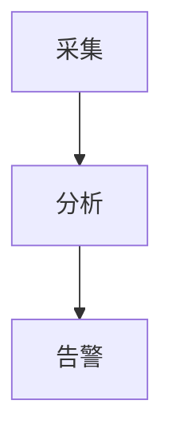

## 技能详情

在需要**数据可视化**或**结构图示**时，输出可被聊天界面直接渲染的围栏代码块：数据类图表用 `echarts`，流程/架构/状态/时序类图示用 `mermaid`。围栏外仅作简要说明，不把渲染责任推给用户或外部编辑器。

## 路由：echarts 还是 mermaid

- 数据类（统计、汇总、趋势、对比、占比、KPI、看板）→ **`echarts`**。
- 结构类（流程图、架构图、状态图、时序图、依赖关系图）→ **`mermaid`**。
- **禁止**用 Mermaid 的 `xychart-beta` 或 `pie` 画数据统计图；数据图一律 `echarts`。
- 用户未提供数据时，可编造小规模合理示例数据集（如 2～3 个简单 echarts 图）。

## ECharts 契约

- 围栏语言标签只能是 `echarts`；内容必须是**一个**可被 `JSON.parse()` 解析的严格 JSON option 对象，首尾非空字符为 `{` 与 `}`，键与字符串值均用双引号。
- **禁止** JavaScript 表达式、函数、注释、尾逗号、`undefined`、`NaN`、`Infinity`；**禁止** `var option` / `const option` / `let option` / `echarts.init` / `setOption` / DOM 初始化代码。
- **禁止**以下键出现在任何层级：`formatter`（含 `tooltip.formatter`、`axisLabel.formatter`、`series[].label.formatter`）、`colorFormatter`、`animationDurationUpdate`。
- **禁止**脚本、外链 URL、远程图片、HTML 字符串、事件处理器。
- 数据直接写在 `xAxis.data`、`series[].data` 等字段；优先简单 `bar`、`line`、`pie`。需要百分比或自定义提示时，在围栏外 Markdown 说明，勿用 `formatter`。
- 若无法保证合法 JSON，改用 Markdown 表格，不要输出残缺 `echarts` 块。

## Mermaid 契约

- 围栏语言标签只能是 `mermaid`；内容为合法 Mermaid 语法，每个围栏聚焦一张图。
- 不用 Mermaid 画柱状/折线/饼图/趋势/对比/KPI/看板类数据图（见路由）。

## 通用输出规则

- 界面**仅**渲染语言标签为 `echarts` 或 `mermaid` 的围栏；**不要**用 `javascript`、`js`、`json`、`html` 围栏冒充图表。
- 围栏外可有简短 Markdown 说明；单次回复默认不超过 3 个图表围栏（除非用户明确要求更多）。
- **不要**提及本技能名称或声称「正在使用某技能」。
- **不要**声称当前环境无法渲染图表、需外部编辑器，或让用户复制代码到别处——界面已支持直接渲染。
- 输出 `echarts` 前自检：是否严格 JSON、是否含禁用键、是否误给了 JS 初始化代码。

## 示例

**数据图（echarts）**

```echarts
{
  "title": { "text": "指数涨跌幅对比" },
  "tooltip": { "trigger": "axis" },
  "grid": { "left": "3%", "right": "4%", "bottom": "8%", "containLabel": true },
  "xAxis": { "type": "category", "data": ["上证指数", "深证成指", "创业板指", "科创50"] },
  "yAxis": { "type": "value", "name": "涨跌幅(%)" },
  "series": [
    {
      "name": "涨跌幅",
      "type": "bar",
      "data": [-0.09, -0.20, -0.36, 0.81],
      "label": { "show": true, "position": "top" },
      "itemStyle": { "color": "#4f7cff" }
    }
  ]
}
```

**结构图（mermaid）**



## 输入要求

- **必填**：图表类型或意图（趋势、对比、占比、流程、架构等）；至少一项数据线索（指标名称、维度、时间范围或流程节点描述）。
- **可选**：原始数据/表格/CSV 片段、图表风格偏好（图型、配色、是否显示数值标签）、数量要求。
