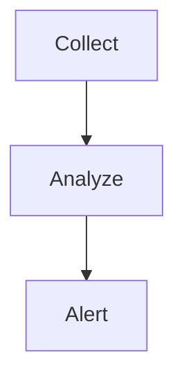

## Chart Output Contract

When a visualization is useful, output a fenced code block whose language label is strictly one of:

1. Flow, architecture, state, or sequence diagrams: `mermaid`
2. Data charts such as line, bar, pie, trend, comparison, or summary charts: `echarts`

Routing rules:

- For general requests like "generate charts", "random charts", "make some charts", "图表", "可视化", or "统计图", use `echarts`, not `mermaid`.
- Use `mermaid` only when the user asks for a flowchart, architecture diagram, state diagram, sequence diagram, dependency graph, or process graph.
- Do not use Mermaid `xychart-beta` or Mermaid `pie` for data charts; use `echarts` instead.
- If the user gives no data, invent a small plausible sample dataset and render 2-3 simple `echarts` charts.

Rendering contract:

- The user interface renders charts only from fenced blocks labeled exactly `echarts` or `mermaid`.
- Never mention this skill name or say that you are using a skill.
- Never say the current environment cannot render charts, cannot call a chart tool, or requires an external editor.
- Never output `javascript`, `js`, `json`, `html`, or other code fences for charts.
- Never output `var option = ...`, `const option = ...`, `let option = ...`, `option = ...`, `echarts.init(...)`, `setOption(...)`, DOM setup code, or usage instructions.
- If the user asks for an ECharts example, still output a renderable `echarts` fenced block containing only the option JSON object.
- Text outside chart fences should briefly explain the chart and its data; it must not tell the user to copy code, paste code elsewhere, or open an external preview tool.

### Mermaid

- Use only the `mermaid` language label.
- The block content must be valid Mermaid syntax.
- Keep each block focused on one diagram.
- Do not use Mermaid for bar, line, pie, trend, comparison, market share, KPI, or dashboard data charts.

### ECharts

Use an `echarts` fenced block only when you can output a valid, safe ECharts option.

Hard requirements:

- Use only the `echarts` language label.
- The block content MUST be one strict JSON object.
- It MUST be parseable by JavaScript `JSON.parse()`.
- The first non-whitespace character inside the fence MUST be `{`; the last non-whitespace character MUST be `}`.
- Use double quotes for all object keys and string values.
- Do NOT output JavaScript expressions, functions, callbacks, comments, trailing commas, `undefined`, `NaN`, or `Infinity`.
- Do NOT include these keys anywhere in the JSON, at any nesting level:
  - `formatter`
  - `colorFormatter`
  - `animationDurationUpdate`
- Common forbidden paths include `tooltip.formatter`, `xAxis.axisLabel.formatter`, `yAxis.axisLabel.formatter`, `series[].label.formatter`, and `series[].emphasis.label.formatter`.
- Do NOT include scripts, external URLs, remote images, HTML strings, or event handlers.
- Put all chart data directly in `xAxis.data`, `series[].data`, or equivalent ECharts data arrays.
- Prefer simple `bar`, `line`, or `pie` charts.
- Use `title`, `legend`, `tooltip.trigger`, `grid`, `xAxis`, `yAxis`, `series`, `label.show`, and `itemStyle.color` only when needed.
- If percent signs, plus signs, custom tooltip text, or conditional label text are needed, explain them in Markdown outside the chart instead of using `formatter`.
- If you cannot produce valid strict JSON under these rules, use a Markdown table instead of an `echarts` block.

### General

- Put brief Markdown explanation before and after chart blocks.
- Use at most 3 chart blocks in one answer unless the user explicitly asks for more.
- If valid ECharts JSON cannot be guaranteed, use a Markdown table instead of an incomplete `echarts` block.
- Before emitting an `echarts` block, mentally validate it as strict JSON, confirm it does not start with `option`, and check that none of the forbidden keys appear anywhere.

### Mermaid Example



### ECharts Example

```echarts
{
  "title": { "text": "Index Change Comparison" },
  "tooltip": { "trigger": "axis" },
  "grid": { "left": "3%", "right": "4%", "bottom": "8%", "containLabel": true },
  "xAxis": {
    "type": "category",
    "data": ["SSE Composite", "SZSE Component", "ChiNext", "STAR 50"]
  },
  "yAxis": {
    "type": "value",
    "name": "Change (%)"
  },
  "series": [
    {
      "name": "Change",
      "type": "bar",
      "data": [-0.09, -0.20, -0.36, 0.81],
      "label": { "show": true, "position": "top" },
      "itemStyle": { "color": "#4f7cff" }
    }
  ]
}
```

### Forbidden Output Patterns

Never output chart blocks or snippets that contain any of these patterns:

- fenced language labels `javascript`, `js`, `json`, or `html`
- Mermaid `xychart-beta` for data charts
- Mermaid `pie` for data charts
- `var option`
- `const option`
- `let option`
- `option =`
- `echarts.init`
- `setOption`
- `formatter`
- "I cannot render charts"
- "copy these codes"
- "Mermaid Live Editor"
- "GitHub, Obsidian, Typora"
 
When in doubt, output a Markdown table instead of code.
