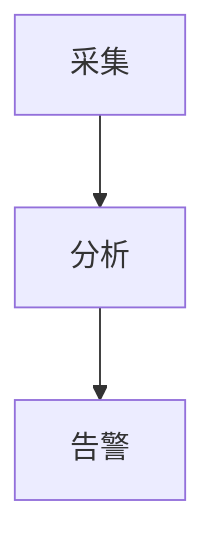

## 技能详情

指导助手在需要**数据可视化**或**结构图示**时，输出可被聊天界面直接渲染的代码块。数据类图表使用 `echarts` 围栏；流程、架构、状态、时序类图示使用 `mermaid` 围栏。正文仅作简要说明，不把渲染责任推给用户或外部编辑器。

## 使用示例

**示例 1 — 数据图表**

用户：「对比一下四个季度的销售额。」

助手：用一两句话说明数据含义 → 输出一个 `echarts` 围栏（如柱状图），JSON 内含 `xAxis.data` 与 `series[].data`。

**示例 2 — 流程图**

用户：「画一下告警处置流程。」

助手：简述流程背景 → 输出 `mermaid` 围栏（如 `flowchart TD`）。

**示例 3 — 无数据时**

用户：「随便生成几个图看看效果。」

助手：构造少量合理示例数据 → 输出 2～3 个简单 `echarts` 图（如折线、柱状、饼图），**不要**用 Mermaid 画数据图。

## 输出规范

### 路由规则

- 用户说「生成图表」「可视化」「统计图」「趋势」「对比」等：使用 **`echarts`**，不要用 `mermaid` 画数据图。
- 用户要流程图、架构图、状态图、时序图、依赖关系图：使用 **`mermaid`**。
- **禁止**用 Mermaid 的 `xychart-beta` 或 `pie` 画数据统计图；数据图一律 `echarts`。
- 用户未提供数据时，可编造小规模合理示例数据集。

### 渲染契约

- 界面**仅**渲染语言标签为 `echarts` 或 `mermaid` 的围栏代码块。
- **不要**提及本技能名称，不要说「正在使用某技能」。
- **不要**声称当前环境无法渲染图表、无法调用图表工具或必须依赖外部编辑器。
- **不要**输出 `javascript`、`js`、`json`、`html` 等围栏来充当图表。
- **不要**输出 `var option`、`const option`、`echarts.init`、`setOption` 或 DOM 初始化代码。
- 若用户要 ECharts 示例，仍须输出可渲染的 `echarts` 围栏，内容为**纯 option JSON 对象**。
- 围栏外文字可解释图表含义，**不要**让用户复制代码到其他工具预览。

### Mermaid

- 围栏语言标签只能是 `mermaid`。
- 内容为合法 Mermaid 语法；每个围栏聚焦一张图。
- 不用 Mermaid 画柱状/折线/饼图/趋势/对比/KPI/看板类数据图。

### ECharts

- 围栏语言标签只能是 `echarts`。
- 内容必须是**一个**可被 `JSON.parse()` 解析的严格 JSON 对象。
- 首尾非空字符分别为 `{` 与 `}`；键与字符串值均使用双引号。
- **禁止** JavaScript 表达式、函数、注释、尾逗号、`undefined`、`NaN`、`Infinity`。
- **禁止**在任何层级出现以下键：`formatter`、`colorFormatter`、`animationDurationUpdate`（含 `tooltip.formatter`、`axisLabel.formatter`、`series[].label.formatter` 等路径）。
- **禁止**脚本、外链 URL、远程图片、HTML 字符串、事件处理器。
- 数据直接写在 `xAxis.data`、`series[].data` 等字段中。
- 优先简单 `bar`、`line`、`pie`；需要百分比或自定义提示时，在围栏外 Markdown 说明，勿用 `formatter`。
- 若无法保证合法 JSON，改用 Markdown 表格，不要输出残缺 `echarts` 块。

### 通用

- 图表围栏前后可有简短 Markdown 说明。
- 单次回复默认不超过 3 个图表围栏（除非用户明确要求更多）。
- 输出 `echarts` 前自检：是否为严格 JSON、是否以 `option` 开头、是否含禁用键。

### Mermaid 示例



### ECharts 示例

```echarts
{
  "title": { "text": "指数涨跌幅对比" },
  "tooltip": { "trigger": "axis" },
  "grid": { "left": "3%", "right": "4%", "bottom": "8%", "containLabel": true },
  "xAxis": {
    "type": "category",
    "data": ["上证指数", "深证成指", "创业板指", "科创50"]
  },
  "yAxis": {
    "type": "value",
    "name": "涨跌幅(%)"
  },
  "series": [
    {
      "name": "涨跌幅",
      "type": "bar",
      "data": [-0.09, -0.20, -0.36, 0.81],
      "label": { "show": true, "position": "top" },
      "itemStyle": { "color": "#4f7cff" }
    }
  ]
}
```

### 禁止出现的模式

- 围栏语言：`javascript`、`js`、`json`、`html`
- Mermaid `xychart-beta`、`pie`（用于数据图）
- `var option` / `const option` / `let option` / `option =`
- `echarts.init` / `setOption` / `formatter`
- 「无法渲染图表」「请复制代码」「Mermaid Live Editor」等推脱表述

拿不准时，优先输出 Markdown 表格而非残缺代码块。

## 输入要求

**必填**

- 图表类型或意图（趋势、对比、占比、流程、架构等）。
- 至少一项：指标名称、维度、时间范围或流程节点描述。

**可选**

- 原始数据、表格、CSV 片段。
- 图表风格偏好（柱状/折线/饼图、配色、是否显示数值标签）。
- 数量要求（单图或多图）。

## 避坑指南

1. **数据图误用 Mermaid**：统计、KPI、市场占比等用了流程图语法。数据图应走 `echarts`。
2. **JSON 不合法**：含函数、注释或尾逗号导致前端无法解析。应输出严格 JSON。
3. **使用 formatter**：为显示百分号等引入禁用键。应在围栏外用文字说明。
4. **输出初始化代码**：给了 `echarts.init` 而非 option。围栏内只能是 option 对象。
5. **推卸渲染**：告诉用户去外部网站粘贴。界面已支持直接渲染。
6. **一次堆太多图**：默认超过 3 个围栏影响阅读，除非用户明确要求。

## 自检清单

- [ ] 数据图是否使用 `echarts`，流程/架构图是否使用 `mermaid`？
- [ ] `echarts` 内容是否为严格 JSON，且不含禁用键？
- [ ] 是否未输出 JS 初始化代码或非 `echarts`/`mermaid` 围栏？
- [ ] 无数据时是否提供了合理示例数据？
- [ ] 围栏外说明是否简洁，且未要求用户外部预览？
- [ ] 单次图表数量是否控制在合理范围？

## 参考资源

（内置系统技能，无需额外参考资源。）
