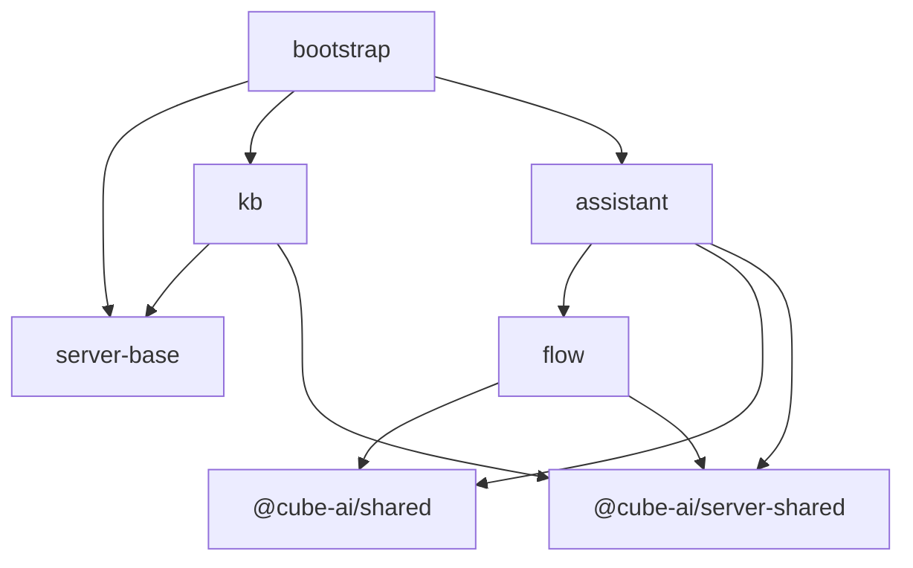

# cube-ai 源仓现状勘察（迁移基线）

> 目的：记录 **`/Users/dg/work-dg/cube-ai/redesign/cube-ai`** 在「全面架构改造——服务拆分」(`400b45e`，HEAD `1c9d172`) 之后的**真实结构**，作为合并入 `cube-ai-project` 的迁移基线，并标出与已落 ADR 的偏差。
>
> 方法：实读代码/README/入口装配。标注「✅实证 / ⚠️推断」。本文是**事实快照**，不是决策；决策见 ADR + 后续 grill。

## 1. 服务地图（server/ 子包）

| 包 | 目录 | 职责（实读） | single 端口 |
|---|---|---|---|
| `@cube-ai/bootstrap` | `server/bootstrap` | 组合根：挂 `AssistantModule` + `AiKbModule`；ConfigModule/LoggerModule/DatabaseModule(sqlite|mysql)/Swagger；`NoopServiceRegistryModule`（Nacos 已停） | 3210 |
| `@cube-ai/server-base` | `server/server-base` | 横切：`loadAppConfig`、`createExecutionAuthMiddleware`、`createProjectContextMiddleware`、`createDeveloperRateLimitMiddleware`、`UnifiedErrorFilter` | 库 |
| `@cube-ai/flow` | `server/flow` | **远超「引擎+DSL」**：见 §3 | 3320 |
| `@cube-ai/assistant` | `server/assistant` | 平台副驾：LLM + tools + flow 转发 + session/SSE：见 §2 | 3321 |
| `@cube-ai/kb` | `server/kb` | 知识库/检索：MySQL + Qdrant + doubao embedding，chunk 耦合：见 §4 | 3322 |
| `@cube-ai/server-shared` | `server/server-shared` | server 域间复用（`currentProjectId` / `isGlobalAccessEnabled` 等） | 库 |
| `@cube-ai/server-mock` | `server/server-mock` | mock 拦截器 | 库 |
| `@cube-ai/shared` | `shared/` | web↔server 共用类型/常量/组件 schema 推导 | 库 |

依赖方向（✅ server/README mermaid + 实读 import）：

**关键**：`assistant` 直接 `imports:[FlowModule]` 且 `import { FlowsService, FlowRepository } from '@cube-ai/flow'`——跨域是 **module/repo 直连，非 contracts port**。整套后端（assistant+flow+kb）由 bootstrap 装成**单进程**（✅ `app.module.ts`）。

## 2. assistant（平台副驾）✅

- `AssistantModule`：`imports:[FlowModule]`，`AssistantController` + `AssistantService`。
- `AssistantService` 注入 `FlowsService` + `FlowRepository`——**assistant 的 session 存在 flow 的 repo**（`listAssistantSessions` / `createAssistantSession`）。
- **自带 LLM 客户端**：`streamOpenAiChatCompletion`（`llm-openai.ts`），配置 `llm-config.ts` 读 `ASSISTANT_API_KEY` / `ASSISTANT_MODEL_BASE_URL` / `ASSISTANT_MODEL`（默认 OpenAI gpt-4o-mini）；出图 `ASSISTANT_IMAGE_*`（dall-e-3）。
- **工具**（`assistant-tools.ts`）面向操作 flow 平台：`list_flows` / `get_flow_summary` / `chat_with_configured_flow` / `generate_image` / `optimize_flow_prompt_template`，`MAX_TOOL_ROUNDS=8`。
- SSE：`sse-read` / `sse-encode` / `assistant-sse-display-accumulate` / `forward-flow-stream`（把 flow 流转发进对话）。
- 定位：**绑定 flow 平台的内置助手**（让用户用自然语言操作/运行 flow、出图、优化 prompt），不是通用 agent。

## 3. flow（范围远超 ADR-0004）✅

107 源文件，含多个明显超出「引擎+Langflow+DSL」的 BC：

| 子域 | 内容 |
|---|---|
| `engine/` | **Cube 线性引擎** `cube-linear-engine` + `linear-chain` + `openai-compat-chat`（自带 OpenAI 调用） |
| `langflow/` | langflow-client、cube↔lf 双向翻译、graph-translator、lf-sse-stream、build-event-mapper、**mcp-reconciler / lf-mcp-server-sync / lf-mcp-tool-options-enrich**、lf-api-all-registry |
| `custom-component/` | **DSL v2**：dsl.schema / dsl-v2.schema / compile-v2 / transpile / lf-template-from-dsl / dsl-to-cube-schema / operators / validate-graph / static-check |
| `flows/` | flows CRUD、execution、langflow-sync、playground、files、monitor |
| `components/` | 组件目录 catalog/schema 推导 |
| `mcp/` | `mcp-tools.controller` + `mcp-list-tools-sdk`（**对外暴露 MCP tools**） |
| `auth/` | **自带鉴权**：auth.service/controller、users.controller、flow-auth-adapters |
| `api-keys/` | 开发者 API key 管理 |
| `projects/` | **project（租户）** 上下文 |
| `settings/` | **`model-providers.controller`**：模型商 apiKey 存 `app_kv` 表（GET 脱敏）= cube-ai 侧 mini-catalog |
| `guardrails/` `observability/` `webhook/` | 护栏、执行指标、webhook（HMAC） |
| `db/` | **sqlite + mysql 双库**（`sqlite.ts` / `mysql-repositories.ts` / `repository-contracts.ts`） |

## 4. kb（与上轮一致）✅

- MySQL（`DatabaseService`）+ Qdrant + doubao embedding。
- `infrastructure/qdrant/`：`qdrant.client`（连接=infra）、`qdrant-vector.repository`（**chunk 耦合**：payload 含 documentId/chunkId/section/heading…，dense+sparse+RRF）、`qdrant-collection.service`、`document-chunk.repository`（MySQL，lexical/BM25 + recall_count）。
- `RetrievalService`：embed(query)→{dense,sparse} → Qdrant 混合 → MySQL 词法 → 合并 → chunk 感知 rerank → section 聚合 → 写回召回计数。**绝大部分是 kb 领域编排，留 kb-core；共享的只是底层 infra `vector-qdrant`（raw 向量 + 不透明 payload）**。

## 5. LLM / 凭据全景（散落 5 处）✅

| # | 位置 | 凭据来源 |
|---|---|---|
| 1 | `assistant/llm-config` | `ASSISTANT_API_KEY` env（+ dall-e 出图） |
| 2 | `flow/engine/cube-linear-engine` | **flow 图节点 config `api_key`** 或 `OPENAI_API_KEY` env |
| 3 | `flow/settings/model-providers` | apiKey 存 **`app_kv` 表**（flow DB） |
| 4 | Langflow 节点 | 外部自持 |
| 5 | `kb` embedding | `embeddingApiKey` / doubao |

> 无任何统一 `llm-core`。ADR-0003「凭据收束」实际收编面比文档大得多；#2 把 vendor key 焊进 flow 图。

## 6. 身份 / 租户 ✅

**上下文载体**：`@cube-ai/server-shared` 提供 `project-context`(`currentProjectId`) / `auth-context` / `developer-api-context` / `access-scope`(`isGlobalAccessEnabled`) / `project-tenant-id`，以 async 上下文承载身份；**各域本体只读这些，不持有身份来源**。

**注入式 seam**：`bootstrap/main.ts` 装配 CORS → 日志 → **`createExecutionAuthMiddleware`**（Bearer/x-api-key，reader 由 flow 提供）→ rate-limit → **`createProjectContextMiddleware`**（`ProjectLookup` 由 flow 的 projectRepo 提供，✅ `flow/middleware/project-context.middleware.ts`）。即身份是**中间件注入**进 server-shared 上下文的，reader/lookup 都是**工厂注入点**。

→ 现状身份/租户**源**在 flow + server-base（非 ghcloud）；`NoopServiceRegistryModule` 示 Nacos 已停。但因身份是注入式 seam，**换源不动域本体**（见 §9 D2/D3 去风险）。

## 7. 与 cube-agentic-engine 的重叠 ⚠️

`cube-agentic-engine`（独立仓，**未并入 cube-ai**）的 `@cube-ai/agent-engine`（agent-engine）BC：`session / auth(OAuth2) / authz(Grant Gateway) / descriptor / tools / jobs(BullMQ) / usage(outbox) / safety / platform / tachu(runtime)` + infra `health/sfid/tenant-guard/errors` + adapters（provider/vector/memory/safety/observability/executionBackend 6 port）。**经源码重核：是最成熟、port 最就位的运行时**——engine 包 279 文件 / ~20.7K 行实现 + ~13.9K 行测试，session/turn/SSE/tool 编排（13 个真实 handler，含 flow/knowledge/vector/llm/mcp）齐全，adapter 真实（Qdrant memory index、anthropic/openai-compat/catalog-routing provider、bullmq backend、rate-limit/idempotency 中间件）。仓名「skeleton」是 **Best-of-N 架构候选代号**（`m2-skeleton-c`），非「代码空壳」；`ARCH.md`（5 月）gap 清单（rate-limit/idempotency/Qdrant 接入）在当前代码已补齐。

→ 它与 cube-ai `assistant` **机制重叠**（chat+LLM+tool+SSE+session），但定位不同（产品级通用 agent vs flow 平台副驾），且**成熟度 engine ≫ assistant**（engine 是 port 就位的成熟运行时；assistant 自带 OpenAI 客户端、session 焊 flow repo，是反模式玩具）。**v6 包计划只有 agent-engine，没有 assistant 的位置——assistant 不迁（D1，已决）。**

## 8. 与已落 ADR 的偏差

| ADR | 偏差 |
|---|---|
| 0001 copy-not-move | ✅ 成立；但源结构已变（多 assistant、flow 变大、bootstrap 是现成单进程） |
| 0002 包边界/port | ⚠️ 新增 assistant 域；现状 module 直连非 port；`@cube-ai/{flow,kb,assistant}` ≠ v6 `{flow-core,kb-core,agent-engine}` |
| 0003 llm/凭据 | ⚠️ 凭据 5 处；flow `model-providers` 是 cube-ai 侧 mini-catalog；node-config 焊 key |
| 0004 flow 合并 | ❌ 重写：flow 含 auth/api-keys/projects/mcp/components/settings/webhook/guardrails/双库，非「引擎+DSL」 |
| 0005 kb/embedding | ✅ 大体符合；vector chunk-coupled 确认；命名 `@cube-ai/kb` |
| 0006 tool/MCP engine-owned | ⚠️ tools 现散 assistant + flow/mcp 两处，非单一 engine |
| 0008 前端路由 | ⚠️ 路由面更大：/assistant /flows /components /settings /mcp /projects /api-keys /webhook /documents /search |
| 0009 单进程+ghcloud adapter | ⚠️ cube-ai 已单进程；身份**自带于 flow** 非 ghcloud；Nacos noop |
| 0011 命名 | ⚠️ `@cube-ai/{bootstrap,server-base,flow,assistant,kb,server-shared,shared}` 需与 v6 命名对照 |

## 9. 关键决策

> **D1（运行时真源）**：**agent-engine 是唯一运行时真源**；cube-ai `assistant` 视为玩具，**不迁移、留原仓**；从 `redesign/cube-ai` 只**整套移植 `flow` 与 `kb`**。
>
> **D2（身份模型）**：身份权威在 **ai-server host**（经 platform-adapter 带入），注入 `server-shared` 上下文；**agent-engine / flow / kb 是三个平级下游域**，各自从上下文消费身份。`agent-engine → flow/kb` 是**能力调用边**，非身份层级；flow 自带独立 SSE（**可直达**，不必经 engine）。三域互不冲突。
>
> **D3（flow 范围）**：迁 **flow 本体整套**（engine / langflow / DSL / components / flows / playground / webhook / guardrails / observability + **projects-as-container**＝flow 领域聚合）；身份/凭据等**横切收归**（身份→host 注入源；凭据→llm-core catalog），经既有**注入 seam 换源、本体不改**。

待定/执行项：

1. **凭据收束** ✅ 已决落地（ADR-0003）——`model-providers`(app_kv)→catalog（**自有存储退役**，UI 统一去 llm console）；flow 节点 config 焊 key→**modelRef + LlmProviderPort**（**软过渡**：legacy key 临时 fallback、数据迁移完 sunset）；kb doubao 经 EmbeddingPort（ADR-0005）；assistant key 弃；Langflow 留长期例外。（一次性 app_kv→catalog 数据迁移机制仍属 ADR-0010 数据迁移未决项）
2. **flow↔assistant 耦合剥离**——flow repo 的 `listAssistantSessions` 等玩具 assistant 残留，迁移时剔除。
3. **api-keys / MCP 归并** ✅ 已决——**MCP**（ADR-0006 #6）：flow 的 mcp 两方向（对外 MCP server + LF MCP 同步）随 flow-core，与 engine **各自装配**；engine↔flow 不经 MCP 回环（只走 FlowInvokerPort）。**api-keys**（ADR-0004/0012）：developer key 认证(key→principal/租户) **统一归 host**（host 备 PAT），flow 只留 key→flows 的 grant 授权；发券 UI 去 host console。
4. **kb 向量分层** ✅ 已决（ADR-0005 修订）——向量存储=**infra**，提取 `infra/vector-qdrant` 共享 Qdrant 驱动；**不设 VectorStorePort**；kb 的 hybrid+chunk 向量层留 kb-core、engine memory 索引留 engine，各自建其上；与 engine 仅共享 raw 向量驱动。

### D3 去风险迁移法（针对「迁移后功能异常」的担心）

1. **先整体 copy flow 跑绿**：flow 整包（含现有横切）原样搬入，先让 flow 自带的大量 `*.test.ts` 全绿——证明搬运无损。
2. **横切已是注入式 seam**（§6）：flow 本体只读 `currentProjectId()`/`isGlobalAccessEnabled()`，身份经中间件工厂注入。"收归" = **在 host 处换注入源，flow 本体一行不改**。
3. **逐处换源 + 回归**：身份源 flow→ai-server host(platform-adapter)；凭据源 model-providers→llm-core catalog。每换一处跑一遍 flow 测试，绿了再换下一处。
4. **projects-as-container 留 flow**：flow 的 projects 聚合（flows 归属 project）是领域数据，不是身份——留 flow；只有"我是谁/属哪个租户"经 host 注入。
