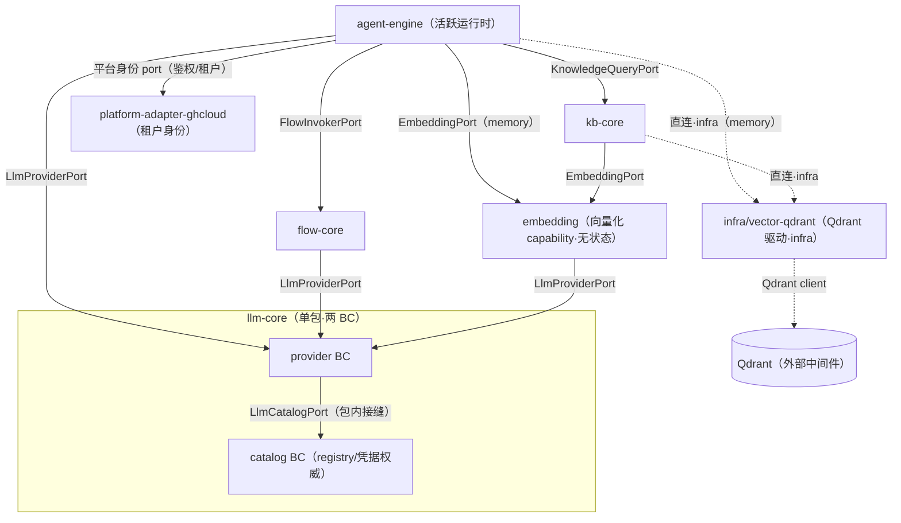
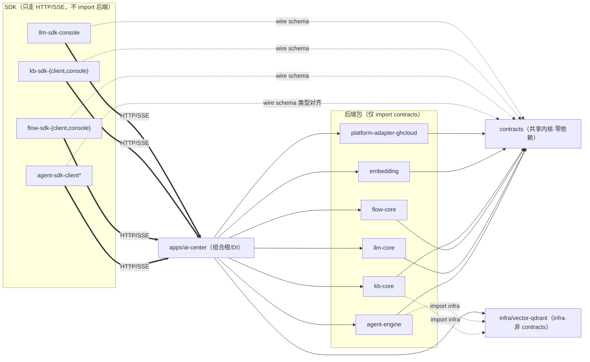

# 仓库布局与子包依赖图

> 配套：CONTEXT.md（术语）、docs/adr/（决策）。本文是 ADR-0001/0002/0005/0009/0011/0012/0014 的**结构落地视图**。
> 约束来源：ADR-0002（包边界与依赖铁律）、**ADR-0005（向量化=capability / 向量存储=infra `vector-qdrant`）**、ADR-0009（单进程拓扑）、**ADR-0011（命名哲学：包=seam、路径派生包名、SDK 按面）**、ADR-0012（运行时单一真源 + 三域平级下游）、ADR-0014（flow-studio 投影层）。

## 1. 目录结构示意

Bun workspaces monorepo。三个顶层根：`packages/*`（能力包与 SDK，多包领域开子目录）、`apps/*`（组合根/部署单元）、`infra/*`（基础设施扩展与测试夹具）。

```
cube-ai-project/
├── AGENTS.md                           # AI 开发入口（渐进式披露索引）
├── CONTEXT.md                          # 领域术语表（glossary）
├── README.md
├── package.json                        # bun workspaces: ["apps/*","packages/*","packages/*/*","infra/*","infra/*/*"]
├── bun.lock · bunfig.toml · tsconfig.base.json
│
├── docs/
│   ├── adr/                            # ADR-0001 .. 0015 + README 索引
│   ├── architecture/                   # 本文所在：结构与依赖视图 + 直连 vendor 例外登记
│   ├── operations/                     # cutover runbook 等运维手册
│   └── backlog.md                      # 未关闭事项清单
│
├── deploy/
│   └── docker-compose/                 # ai-center(1 容器) + MySQL/Redis/Qdrant(+可选 Nacos/otel)（ADR-0009）
│
├── descriptors/                        # 声明式资产：agents / tools / skills / rules
├── config/                             # mcp-servers 等本地配置（example 入库，实配 gitignore）
├── scripts/                            # 构建/发布/容器测试脚本（见各文件头注释）
├── tools/
│   └── migration/                      # ghcloud catalog 数据迁移脚本（cutover 完成后删除）
├── patches/                            # bun patch 产物（按需）
│
├── apps/
│   ├── ai-center/                      # ★ 单进程组合根（ADR-0009）
│   │   ├── src/bootstrap.ts            #   DI 装配：agent-engine + flow-core + kb-core + llm-core + embedding 经 port 互调（向量存储 infra/vector-qdrant 直连）
│   │   ├── src/routes/                 #   领域路由 /agent/* /flow/* /kb/* /llm/*（装配期施加域×面前缀）+ LLM 网关 /v1/*（豁免，ADR-0003）；见 ADR-0008 addendum 两轴方案
│   │   ├── src/platform/               #   server-base/server-shared/server-mock 横切基础设施
│   │   └── src/main.ts                 #   进程入口 + 后台 loop（worker.* / SSE drain）
│   └── ai-sdk-playground/              # @cube-ai/ai-sdk-playground —— SDK 验证沙箱
│
├── packages/
│   ├── contracts/                      # ★ 唯一共享内核（零依赖，仅 zod）→ @cube-ai/contracts
│   │   └── src/platform/               #   FlowInvokerPort · KnowledgeQueryPort · LlmCatalogPort
│   │       │                           #   LlmProviderPort · EmbeddingPort（向量存储无 port，是 infra）
│   │       └── (wire schema · 不变量常量)
│   │
│   ├── agent/                          # 领域分组目录（无 package.json）
│   │   ├── engine/                     # @cube-ai/agent-engine —— 活跃运行时
│   │   │   └── src/bc/                 #   session · tools(+mcp-bridge) · jobs · safety · authz · usage …
│   │   ├── sdk-client/                 # @cube-ai/agent-sdk-client（框架无关消费面）
│   │   ├── sdk-client-vue/             # @cube-ai/agent-sdk-client-vue
│   │   ├── sdk-client-assistant/       # @cube-ai/agent-sdk-client-assistant
│   │   └── sdk-client-mock/            # @cube-ai/agent-sdk-client-mock
│   │
│   ├── llm/                            # 多包领域
│   │   ├── core/                       # @cube-ai/llm-core —— provider BC + catalog BC（registry/凭据权威）
│   │   │   └── src/{provider,catalog}/ #   provider：chat·stream·embed·tool·vision + 网关面 /v1/*（豁免，ADR-0003）+ 消费面 /llm/providers
│   │   │                               #   catalog：model registry + 远程同步 + 连通测试，管理面 /llm/console/*
│   │   └── sdk-console/                # @cube-ai/llm-sdk-console —— 模型接入管理面
│   │
│   ├── flow/                           # 多包领域
│   │   ├── core/                       # @cube-ai/flow-core —— cube 线性引擎 · Langflow adapter · DSL 编译
│   │   ├── studio/                     # @cube-ai/flow-studio —— flow-editor 投影层（editorFlowJson → DSL v2，ADR-0014）
│   │   ├── sdk-client/                 # @cube-ai/flow-sdk-client —— 执行 + editor-model 面
│   │   └── sdk-console/                # @cube-ai/flow-sdk-console —— 管理面
│   │
│   ├── kb/                             # 多包领域
│   │   ├── core/                       # @cube-ai/kb-core —— ingestion(切片) · retrieval · object-storage
│   │   ├── sdk-client/                 # @cube-ai/kb-sdk-client —— 检索
│   │   └── sdk-console/                # @cube-ai/kb-sdk-console —— 文档管理
│   │
│   ├── embedding/                      # @cube-ai/embedding —— 单包扁平·向量化 capability（文本→向量，经 LlmProviderPort.embed）
│   │                                   #   embedding=capability(port)；向量存储=infra(vector-qdrant，见 infra/)（ADR-0005）
│   │
│   └── platform-adapters/              # 集合目录（复数）；包名前缀单数化
│       └── ghcloud/                    # @cube-ai/platform-adapter-ghcloud —— 平台租户身份（鉴权/租户解析）+ cube2 桥
│
└── infra/
    ├── bun-server-ext/                 # 框架扩展（单数目录）
    │   ├── sse/                        # @cube-ai/bun-server-ext-sse
    │   ├── outbox/                     # @cube-ai/bun-server-ext-outbox
    │   └── nacos/                      # @cube-ai/bun-server-ext-nacos
    ├── vector-qdrant/                  # @cube-ai/vector-qdrant —— 共享 Qdrant 驱动（向量存储 infra，kb/engine 直连，ADR-0005）
    └── test-infra/                     # @cube-ai/test-infra —— 共享测试夹具 / in-memory adapter
```

**注**：`apps/ai-center` 是组合根/单进程宿主，把各能力包经 contracts port + DI 装配为一个 Bun 进程（ADR-0009）；`packages/*` 内部彼此**不直接 import 实现**，只认 contracts port。领域分组目录（`agent/`、`flow/`、`kb/`、`llm/`、`platform-adapters/`）不含 `package.json`，workspaces glob 只命中叶子包。

## 2. 包名 ↔ 路径派生速查（ADR-0011）

包名 = `@cube-ai/` + 去顶层根后的路径段以 `-` 连接；集合目录前缀单数化。

| 磁盘路径                             | 包名                                | 备注                                         |
| ------------------------------------ | ----------------------------------- | -------------------------------------------- |
| `packages/contracts`                 | `@cube-ai/contracts`                | 单包扁平                                     |
| `packages/agent/engine`              | `@cube-ai/agent-engine`             | 活跃运行时（`engine` 非 `core`）             |
| `packages/agent/sdk-client-vue`      | `@cube-ai/agent-sdk-client-vue`     | client 面 + 框架后缀                         |
| `packages/llm/core`                  | `@cube-ai/llm-core`                 | provider + catalog 两 BC                     |
| `packages/llm/sdk-console`           | `@cube-ai/llm-sdk-console`          | console 面                                   |
| `packages/flow/core`                 | `@cube-ai/flow-core`                | 被动库（`core`）                             |
| `packages/flow/studio`               | `@cube-ai/flow-studio`              | 编辑器投影层（ADR-0014）                     |
| `packages/kb/sdk-client`             | `@cube-ai/kb-sdk-client`            | client 面                                    |
| `packages/embedding`                 | `@cube-ai/embedding`                | 单包扁平·向量化 capability                   |
| `packages/platform-adapters/ghcloud` | `@cube-ai/platform-adapter-ghcloud` | 集合目录复数→前缀单数                        |
| `infra/bun-server-ext/sse`           | `@cube-ai/bun-server-ext-sse`       | 框架名单数                                   |
| `infra/vector-qdrant`                | `@cube-ai/vector-qdrant`            | 向量存储 infra·Qdrant 驱动（kb/engine 直连） |
| `infra/test-infra`                   | `@cube-ai/test-infra`               |                                              |
| `apps/ai-center`                     | `@cube-ai/ai-center`                | 组合根 app                                   |
| `apps/ai-sdk-playground`             | `@cube-ai/ai-sdk-playground`        | 内部 SDK 验证沙箱                            |

## 3. 运行时端口图（必须无环，ADR-0002）

跨领域耦合只发生在 contracts port 上；下图为允许的有向边，禁止任何反向边。catalog 权威收编后，原 `llm → ghcloud` 的 catalog 边退化为 `llm-core` **包内** provider/catalog 两 BC 的接缝；ghcloud 仅剩平台身份边。



**禁止反向边**：`llm-core → embedding`、`embedding → kb-core`、`vector-qdrant → *`（infra 不反依赖能力包）、`* → agent-engine`。新增能力消费关系前必须确认不引入环。

## 4. Import 依赖视图（contracts 为唯一共享内核）

所有后端包都只 import `contracts`（port/schema/常量）；能力间的「消费」在运行时经 DI 注入 adapter 完成，不是编译期 import 对方实现。SDK 不 import 任何后端包。



## 5. 依赖速查表

| 包                                          | 编译期 import                           | 运行时经 port 消费                                                                  | 对外暴露                                                                                               |
| ------------------------------------------- | --------------------------------------- | ----------------------------------------------------------------------------------- | ------------------------------------------------------------------------------------------------------ |
| `contracts`                                 | （仅 zod）                              | —                                                                                   | 所有 port / wire schema / 常量                                                                         |
| `agent-engine`                              | contracts（+ 直连 infra/vector-qdrant） | flow-core · kb-core · llm-core · embedding(memory) · platform-adapter-ghcloud(身份) | 运行时核心（消费 ports；向量存储直连 infra）                                                           |
| `llm-core`                                  | contracts                               | —（provider/catalog 两 BC 包内自洽，经包内 `LlmCatalogPort`）                       | `LlmProviderPort` + 消费面 `/llm/providers` + 管理面 `/llm/console/*` + 网关 `/v1/*`（豁免，ADR-0003） |
| `flow-core`                                 | contracts                               | llm-core                                                                            | `FlowInvokerPort`                                                                                      |
| `kb-core`                                   | contracts（+ 直连 infra/vector-qdrant） | embedding                                                                           | `KnowledgeQueryPort`                                                                                   |
| `embedding`                                 | contracts                               | llm-core（embed）                                                                   | `EmbeddingPort`                                                                                        |
| `infra/vector-qdrant`                       | （Qdrant client lib）                   | —（infra，被 kb/engine 直连，不反依赖能力包）                                       | 共享 Qdrant 驱动（无 contracts port）                                                                  |
| `platform-adapter-ghcloud`                  | contracts                               | —（被 DI 装配）                                                                     | 平台身份 port（鉴权/租户解析）                                                                         |
| `agent-sdk-client*` / `<domain>-sdk-<face>` | （仅 contracts wire schema 类型）       | — HTTP/SSE                                                                          | 前端消费面(client) / 管理面(console)                                                                   |
| `apps/ai-center`                            | 所有后端包                              | （组合根，DI 装配 port↔adapter）                                                    | 单进程宿主 + 领域路由                                                                                  |

铁律一句话：**跨领域耦合只有 contracts port 一种；contracts 是唯一可被自由 import 的共享内核。** model registry / vendor 凭据权威单源于 `llm-core`，ghcloud 退为租户身份提供方。
