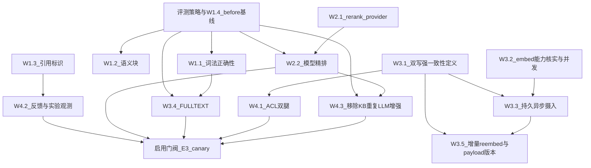

# 00 — 总览：目标、依赖与交付约定

## 1. 目标与边界

本计划处理 KB/RAG 的检索正确性、评测、数据一致性、访问控制、摄入可靠性、观测和质量增强。架构分层“看起来合理”不构成生产成熟证据；每项结论必须落到 E0～E3 证据、严格不变量或书面决策。

本目录不承担业务代码完成状态认证；见 [DELIVERY-MATRIX.md](./DELIVERY-MATRIX.md)。

## 2. 修订后的依赖

关键修正：

- W1.4 before 基线先于 W1.1/W1.2，否则无法证明改造前后差异。
- W4.1 不再依赖 W2.2；安全隔离不应等待质量优化，真正前置是 W3.1 与身份/ACL 决策。
- rerank/FULLTEXT 的 live 实验必须记录版本与曝光；延期的用户 feedback API 不是实验前置。
- 代码合并依赖与能力启用依赖分开；后者统一进入 E3 canary 门阀。

## 3. 问题映射

| 报告 | 落地文档 | 完成含义 |
| --- | --- | --- |
| F-01 无模型精排 | W2.1 + W2.2 | E3 证明收益后才是能力完成 |
| F-02 无评估体系 | W1.4 + EVALUATION-STRATEGY + W4.2 | 指标单测不等于 live 闭环 |
| F-03 词法正确性/性能 | W1.1 → W3.4 | 正确性与性能分别验收 |
| F-04 无引用 | W1.3 | 结构化 chunk 锚点与 tenant-scoped 详情分别验收 |
| F-05/F-10 ACL·元数据 | W4.1 + 安全不变量 | 双腿、身份、更新窗口和索引均满足 |
| F-06 双写 | W3.1 + 一致性不变量 | ID、embedding/payload version、deletion 收敛；向量字节完整性按独立 checksum/抽样门阀验收 |
| F-07 embed 串行 | W3.2 | 先核实 vendor capability，再选 batch 或并发 |
| F-08 无反馈 | W4.2 | 用户反馈暂缓；操作观测不随之延期 |
| F-09/F-13 查询·上下文 | W4.3 | query rewrite 归 Agent；KB 保留确定性上下文并移除重复 LLM 调用 |
| F-11 阈值未校准 | W2.2 + EVALUATION-STRATEGY | 真实模型/目标环境标定 |
| F-12 双分块 | W1.2 | 仅保留满足质量/长度约束的 parser chunk |
| F-14 多模态闲置 | W4.4 | 暂缓，需 dataset + ROI 准入 |
| F-15 单 collection | W4.1 非目标 | 容量/噪声证明后再立项 |
| F-16 同步摄入 | W3.3 | 持久 job、lease、幂等、恢复和观测 |
| F-17 per-KB 配置 | W4.5 | 暂缓 |
| W3.3 失败运营闭环 | W4.6 | 暂缓；异步默认关闭，自动重试/失败终态能力代码保留 |
| R-07 增量 re-embed | W3.5 | 文本与 payload 版本独立 |

## 4. 交付轨道

### G0：决策与基线

- 回填 EVAL-01..04 owner；SEC-01、CON-01、QUEUE-01 已冻结方案，SEC-02 延期。
- W1.4 登记改造前 E1；目标环境具备时登记 E3。
- 完成目标环境数据/容量盘点。

### G1：正确性与安全

- W1.1/W1.2 经过 before/after。
- W3.1 满足严格版本一致性。
- W4.1 满足身份契约、双腿过滤、payload index 和 ACL 更新 fail-closed。

### G2：可靠性与观测

- W3.2 provider capability 已由官方文档或契约测试确认。
- W3.3 满足持久队列不变量；W3.5 不混淆 embedding/payload 变化。
- W1.3/W4.2 建立来源标识、曝光和反馈闭环。

### G3：质量增强实验

- W2.1/W2.2、W3.4、W4.3 分别 shadow/canary。
- 默认开启须通过 E3、成本/延迟预算和 rollout 证据包。

## 5. PR 与文档纪律

- 一个主题 PR 对应一个 W；安全/数据协议可先独立 contracts/migration PR。
- PR 必须填写 W 编号、F/R 编号、影响的不变量、E0～E3 证据级别及 rollout 影响。
- 各 W 的实施清单不表达完成状态；完成状态只在 DELIVERY-MATRIX 根据链接证据更新。
- 涉及检索行为、schema、ACL、队列或外部模型时，必须引用相应跨波次文档。
- 临时报告和真实语料放 `.tmp/`，不得提交密钥、用户原文或真实 tenant 信息。

## 6. 开工闸

此前“Wave0 已完成/未提交/merged”存在互相矛盾，已移入 DELIVERY-MATRIX 做证据审计。新的开工闸不是某个文字状态，而是：负责人、before 基线、关键安全决策和目标环境盘点全部可核验。
